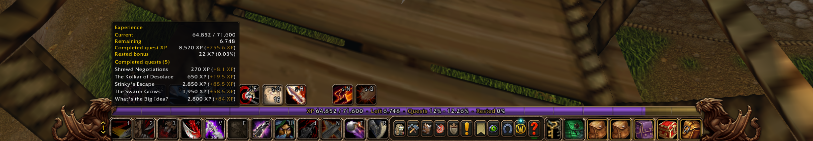

# Experience

A lightweight, Vanilla-inspired experience bar for **World of Warcraft: Forever**.

Experience builds on the game's native XP bar, keeping the familiar look and placement while making your progress easier to read. It shows your current XP, completed quest rewards, a fixed +3% quest XP projection, and rested XP—without turning the bar into a separate UI panel.

## Features

- **Native bar integration** — follows the game's experience bar instead of adding a movable replacement.
- **At-a-glance progress** — current XP, XP remaining, quest progress, and rested XP in one compact line.
- **Completed quest preview** — see how much XP your completed, unturned-in quests are worth.
- **+3% quest projection** — a separate estimate for an additional 3% of quest XP, including per-quest details.
- **Rested XP** — displays the game's reported rested XP pool independently from quest rewards.
- **Hover details** — a compact quest breakdown, with scrolling when the list is long.
- **Lightweight updates** — event-driven XP and quest tracking, without continuous frame-by-frame polling.

## Reading the bar

The visual segments appear in this order:

**Current XP → Completed quests → +3% projection → Rested XP**

The quest and rested sections are previews, **not XP already earned**. Each segment is drawn separately and limited to the available bar space.

### About the +3% estimate

The bonus is a simple, fixed calculation—not an automatic buff detector.

For example, a completed quest worth **4,000 XP** is shown with a projected **+120 XP**, or **4,120 XP** in total if that bonus applies.

- It does **not** scan buffs or track Well-Rested stacks.
- It does **not** change quest rewards or the XP actually granted by the game.
- Rested XP is tracked separately; it generally applies to eligible kill XP, not quest turn-ins.

## Installation

1. Download or copy the `Experience` addon folder.
2. Place it in your WoW Forever AddOns directory:

   ```text
   World of Warcraft/_forever_/Interface/AddOns/Experience/
   ```

3. Make sure `Experience.toc` is directly inside that folder.
4. Launch the game or type `/reload` if the addon was already installed.

The expected layout includes:

```text
Experience/
├── Experience.toc
├── Experience.lua
├── XPData.lua
├── NativeBar.lua
├── BarText.lua
├── Tooltip.lua
├── Media/
│   └── RoundedBarMask.png
└── assets/
    └── experience-preview.png
```

## Slash commands

| Command | Purpose |
| --- | --- |
| `/experience` | Show basic addon and client information |
| `/experience data` | Print current XP, rested XP, and quest data diagnostics |
| `/experience bar` | Print bar state and alignment diagnostics |
| `/experience text` | Print text width, fit, and font diagnostics |

These commands are intended for inspection and troubleshooting; the bar works automatically during normal play.

## Design principles

Experience is intentionally small in scope:

- Preserve the native WoW UI's proportions and Vanilla feel.
- Keep relevant information readable without clutter.
- Prefer event-driven updates over polling.
- Avoid unnecessary dependencies, configuration systems, and visual effects.

## Notes

- Quest previews rely on reward information provided by the game client. If a reward is unavailable, it may be shown as unknown rather than guessed.
- The +3% value is **hypothetical** and is not added to your character's actual XP.
- Bar proportions and rendering may vary with UI scale and native interface changes.

---

**Experience** · World of Warcraft: Forever · Lua addon
